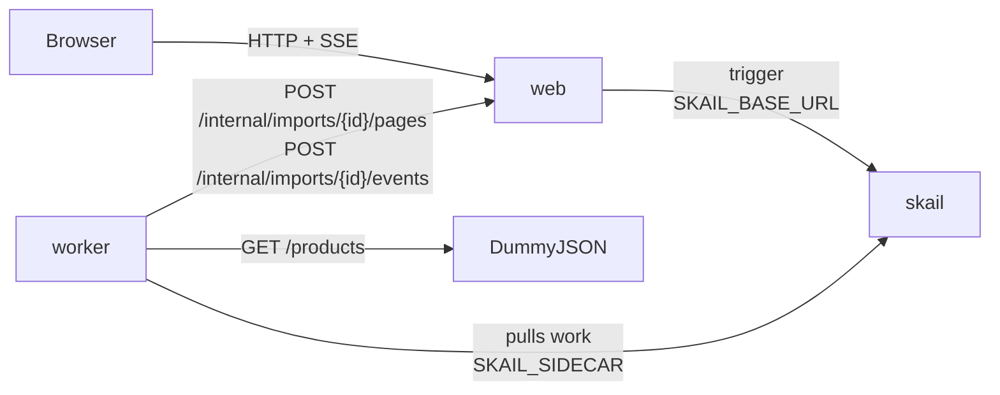

# skail catalog import (Node / TypeScript + React)

[Português (Brasil)](README.pt-BR.md)

A skail function imports a product catalog from an external API, 20 products per page, and waits 2 seconds between pages, the rate limit of the source. Each page is a command: when a page fails, skail retries only that page, and when the worker stops in the middle, the import continues at the page where it stopped, without reading again the pages already imported. The demo imports the 194 products of DummyJSON in 10 pages. A React page starts the import, shows each page as it is written and has a checkbox that makes the target catalog reject page 3 twice.

The demo covers three topics of the [skail docs](https://docs.skail.dev) (in Portuguese):

- [hibernation and resume](https://docs.skail.dev/construa/conceitos/hibernacao-e-retomada): after a crash, the run continues at the page where it stopped;
- [retries and idempotence](https://docs.skail.dev/construa/conceitos/retries-e-idempotencia): a failed page is retried alone, and writing it again replaces it;
- [passing data between function and commands](https://docs.skail.dev/construa/como-fazer/passar-dados-entre-funcao-e-commands): the products stay inside the command, and only the count goes to the run history.

## How it works



- **worker** (`apps/worker`): the function `ImportCatalog(importId)` and its commands. `ImportPage(importId, page)` reads a page from the source and writes it to the target catalog; `ReportStatus` tells the web page how the run is going. The commands delegate to `CatalogOperations`, so their logic is tested without skail.
- **web** (`apps/web`): API and static files. It starts the run (trigger), plays the target catalog with the products in memory and streams the state to the page (SSE).
- **frontend** (`apps/frontend`): the page, in React 18, Vite and TypeScript.
- **contracts** (`apps/contracts`): types, constants and pure rules shared by the other three. It also goes into the skail bundle, so it has no Node I/O imports.

The function only orchestrates and leaves the I/O to the commands. The 2-second wait is a durable delay ([time and scheduling](https://docs.skail.dev/construa/conceitos/tempo-e-agendamento)), which holds no thread or process. Simplified from [`catalog-functions.ts`](apps/worker/src/catalog-functions.ts), which also reports the start, the end and a failure to the web page:

```ts
let page = 1;
let products = 0;
while (true) {
  const result = await this.ImportPage(importId, page);
  products += result.imported;
  if (!result.hasMore || result.imported === 0 || page === CatalogLimits.maxPages) break;

  page++;
  await Skail.delaySeconds(CatalogLimits.secondsBetweenPages);
}
return { importId, pages: page, products };
```

`page` and `products` come only from the results of `ImportPage`. On a resume, skail runs the function again over the run history: the pages already imported return the recorded result without reading the source, and the loop continues at the next page.

`ImportPage` reads and writes in the same command. A retry runs both again: the read changes nothing, and the target replaces a page written twice (the import id and the page number are the key), so nothing is duplicated. The products never leave the command: the result has only the number of products imported and whether there are more pages.

The loop stops when the source says there is no more, when a page comes empty, or at page 50. The cap keeps the run history bounded if the source never reports the end (see [limits](https://docs.skail.dev/referencia/limites-e-cotas)).

## The paths

The web page has an **Import catalog** button and the checkbox **Make the target catalog reject page 3 twice**.

| What you do | What happens | Result |
|---|---|---|
| **Import catalog** | 10 pages, nine of 20 products and the last of 14, 2 seconds apart | **Completed**, 194 products in 10 pages |
| Check the box, then **Import catalog** | the target answers `503` to the first two writes of page 3; skail retries only that page, and the import goes on | **Completed**, with 3 attempts on page 3 |
| `scripts/run.sh kill-worker` in the middle, then `scripts/run.sh start-worker` | the import continues at the next page | **Completed**, with 1 attempt on the pages imported before the crash |

The **Attempts** column counts the writes the target received for each page. While page 3 is rejected, its row shows "rejected, retrying". When a page fails on every attempt, the function reports **Failed** with the page number and the error, and the pages already written stay written. The countdown between pages is only visual: the real wait is the delay in skail. Reloading the web page during an import reconnects to it.

## How it connects to skail

| Service | Variable | Used for |
|---|---|---|
| worker | `SKAIL_SIDECAR` | Connects the function to your environment and receives its work. |
| web | `SKAIL_BASE_URL` | Starts runs through the skail HTTP API. |

Both use the same `SKAIL_WORKLOAD`, `SKAIL_NAMESPACE` and `SKAIL_KEY`. The web app makes one call per import:

```http
POST {SKAIL_BASE_URL}/api/v1/trigger/{name}/{version}/ImportCatalog/{importId}
["{importId}"]
```

`{name}` and `{version}` come from `SKAIL_WORKLOAD` (`name:version`). The call sends the key in `skail-key` and in `Authorization: Bearer`, plus the `Skail-namespace` header, as described in [authentication](https://docs.skail.dev/referencia/api-http/autenticacao). `429`, `5xx` and network errors are retried with the same import id. `401` and `403` are not retried: check `SKAIL_KEY` and `SKAIL_NAMESPACE`.

The browser never calls skail. It only talks to the web app, so the key stays on the server.

## Requirements

- Node 20, 22 or 24 and pnpm 10 (`npm i -g pnpm@10.34.7`)
- podman or docker
- PowerShell 7+ (`pwsh`), only if you use `scripts/run.ps1` instead of `scripts/run.sh`
- A skail environment with the workload from `SKAIL_WORKLOAD` registered (`catalogimport:v1.0.0` by default). The [Quickstart](https://docs.skail.dev/comece-aqui/quickstart) shows how to get an account, create the environment and register the workload.
- Access to the public npm registry, where `@skail/runtime`, `@skail/testing` (2.0.1-rc1) and `@skail/build` (2.0.0) come from.
- Access to <https://dummyjson.com>, where the products come from. Without it, use `SOURCE_PROVIDER=fake`, which serves the same 194 products offline.
- A current browser (Chrome/Edge 111+, Firefox 113+, Safari 16.2+). The page uses Server-Sent Events and CSS `color-mix()`.

## Configure

```bash
cp .env.example .env     # .env holds the key and is ignored by git
```

Fill in `SKAIL_WORKLOAD` (exactly as registered in the portal), `SKAIL_NAMESPACE`, `SKAIL_KEY`, `SKAIL_SIDECAR` and `SKAIL_BASE_URL` with the values of your environment.

The skail bundle cannot read environment variables, so the worker gets `SKAIL_WORKLOAD`, `WEB_BASE_URL`, `SOURCE_PROVIDER` and `SOURCE_API_URL` when it is built ([`gen-config.mjs`](apps/worker/scripts/gen-config.mjs)). After changing them in `.env`, build again; `scripts/run.sh up` does it.

## Run with podman or docker

```bash
scripts/run.sh up        # builds both images and starts web + worker
scripts/run.sh logs
scripts/run.sh down
```

`CONTAINER_ENGINE=docker` forces docker. On Windows, or anywhere with PowerShell 7+, run `pwsh scripts/run.ps1 <command>` with the same commands; `$env:CONTAINER_ENGINE = "docker"` forces docker.

Open <http://localhost:8080> and press **Import catalog**.

### See the durability

1. Press **Import catalog**.
2. After a few pages, run `scripts/run.sh kill-worker`. It kills the worker with SIGKILL, like a crash; the import stops, and the web app keeps the page state.
3. Run `scripts/run.sh start-worker`.
4. The import continues at the next page and ends with 194 products. The pages imported before the crash show 1 attempt, because they were not read again. If the crash hit a page in the middle of its write, that page shows 2 attempts, and the target keeps a single copy of it.

In the portal, open the [Monitor](https://docs.skail.dev/referencia/portal/monitor) of your environment and search for the import id, which the web page shows at the bottom. The run lists `ReportStatus`, then `ImportPage` and `Delay` for each page, with no `Delay` after the last one, and a final `ReportStatus`. With the simulated failure, the rejected attempts of page 3 show up as errors next to its `ImportPage`, with the message `Target catalog answered 503 to the write of page 3: simulated failure on page 3`. In a run without failures, **E2E Duration** was 21.3 s and **Duration** was 1.7 s, because the waits between pages do not use the worker.

## VS Code

Open the folder and accept the recommended extensions.

- `Ctrl+Shift+B` builds, the *test* task runs the tests and the `containers: up/down/logs/kill-worker/start-worker` tasks call `scripts/run.sh`.
- The **Worker + Web** debug configuration starts both apps reading `.env`, and a breakpoint inside a command works. Its build task bakes `WEB_BASE_URL=http://localhost:8080` into the bundle, because outside containers the web app is on `localhost`.
- For the page with hot reload, run the `dev: front end (vite)` task. It forwards `/api` to the web app on port 8080.

## Tests

```bash
pnpm install
pnpm test
```

The unit tests cover the contracts, the source (DummyJSON and offline), the calls to the target catalog and to the web app, the operations behind the commands, the function in memory with `@skail/testing` (10 pages with 9 delays, a rejected page retried alone, a page that fails for good, the 50-page cap), the `skail build` of the worker, the import store (attempts, simulated failure, a page written twice), the calls to skail (trigger), the web API with SSE and the React page. They need neither network nor skail.

## Notes

- The target catalog lives in the memory of the web app. Restarting it loses the products and the page history; the import keeps running in skail, but the web app ignores the pages of imports it does not know. A real target would be a table with an upsert by import id and page (see [idempotent commands](https://docs.skail.dev/construa/como-fazer/escrever-commands-idempotentes)).
- DummyJSON is a public test API with no SLA. When it fails, skail retries the page as it does with the simulated failure.
- The `/internal/imports/...` routes, which the worker calls, have no authentication. That is fine for a local demo; protect them before using the pattern in production.
- Workers with the same `SKAIL_WORKLOAD` on the same environment share the same runs: use one workload (or environment) per person.

## License

[Apache-2.0](LICENSE)
